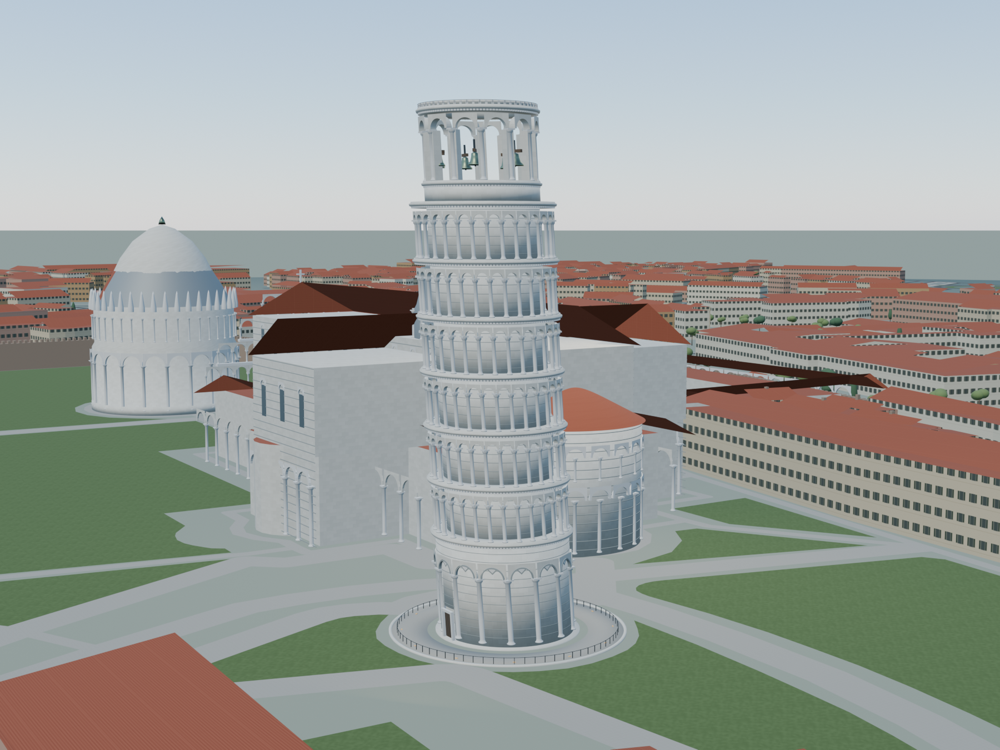

# 比萨斜塔 · 奇迹广场 / Torre Pendente

Blender 5.2.1 LTS 建筑作品集资产。制作于 2026-10-20–21，执行 [CS-AM-1](../../docs/modeling-requirements.md)。[任务书](model-brief.md)说明尺寸、资料冲突、精度与制作取舍。



## 成品与直接地址

| 内容 | 文件 | 发布地址 |
| --- | --- | --- |
| 可编辑工程，打包真实纹理 | [pisa-tower.blend](pisa-tower.blend) | [下载](https://jt-ai-models.vercel.app/models/pisa-tower/pisa-tower.blend) |
| 完整静态主体 | [pisa-tower.glb](pisa-tower.glb) | [下载](https://jt-ai-models.vercel.app/models/pisa-tower/pisa-tower.glb) |
| 28秒八向飞入拼装 | [pisa-tower-assembly.glb](pisa-tower-assembly.glb) | [下载](https://jt-ai-models.vercel.app/models/pisa-tower/pisa-tower-assembly.glb) |
| 12秒爆炸分解 | [pisa-tower-explode.glb](pisa-tower-explode.glb) | [下载](https://jt-ai-models.vercel.app/models/pisa-tower/pisa-tower-explode.glb) |
| 半径1000米街区 | [tileset.json](../../model-assets/geo-context/pisa-1000-v1/tileset.json) | [3D Tiles入口](https://jt-ai-models.vercel.app/model-assets/geo-context/pisa-1000-v1/tileset.json) |
| 发布描述 | [model.json](model.json) | [model.json](https://jt-ai-models.vercel.app/models/pisa-tower/model.json) |

主体约39.8万三角面、224个运动逻辑件；保留基础、空心筒体、首层15个盲拱柱头、六层共180根柱廊柱、12根钟室柱、雕饰解释性柱头、层叠檐口、南入口、展示性螺旋梯、七口铜钟和顶层护栏。柱廊按三跨模块运动，石材、装饰、钟及支架随所属枢轴。最终准确统计、文件大小、摘要和动画边界见 [asset-audit.json](verification/asset-audit.json)。

街区另有2664个真实建筑轮廓、2027段源道路、835个有来源的树位。主要景观包括大教堂、洗礼堂、Camposanto，按实景与OSM占地重建识别特征。街区约49万三角面，按空间网格组织对象，作为一个GLB内容发布；尚无瓦片LOD和实际GPU性能数据。源高度、楼层推算、类型推算分别记录，粉刷墙、百叶窗、赤陶屋面和树形为展示近似。

## 源工程与动画

打开工程选择 `PISA_TOWER` 场景，默认位于28秒成品保持段。`PISA_ASSET` 为正式主体、`PISA_CONTEXT` 为独立街区、`PISA_PREVIEW_ONLY` 为摄影机/灯/背景。仅正式资产集合导出，GLB不含预览灯、摄影机或背景地面。

组装 `BUILD_ASSEMBLY`：30fps，帧0–840，共28秒。0–1秒空主体，基础/筒体、石檐、六层柱廊错峰到位，24–28秒保持。起点覆盖八个方位，部件有真实位移、短弧转动和上抬避让；不以整塔缩放代替组装。地面和街区保留，GEO_ROOT始终固定。

其中22个邻近大教堂方向的构件先在85米高处跨越邻楼，再在斜塔场地内下降。按20Hz以构件包围盒对相邻建筑轮廓及保守高度检查，未再检出邻楼候选交叠，见 `verification/path-clearance.json`；这不等于精确网格碰撞或物理施工验证。影片末段缓慢环绕推进。

爆炸 `BUILD_EXPLODE`：30fps，帧0–360，共12秒，1–9秒按层高和径向展开，9–12秒保持。源工程保留两套可编辑Action，以下命令整体切换并保存工作副本：

```powershell
blender -b pisa-tower.blend --python scripts/animate.py -- explode
blender -b pisa-tower.blend --python scripts/animate.py -- assembly
```

正式GLB分别只有一个全楼clip，共同时间原点为0；未播放时默认装配姿态。每个运动节点的ID、装配TRS、依赖、枢轴和路径见 [parts.json](parts.json)，片段说明见 [animation.json](animation.json)。这是展示装配，内部梯段、雕刻和避让轨迹均不表示文保级内部测量或物理施工。

## 重现

从本目录运行。外部Python依赖为NumPy、Pillow、requests、pyproj、Shapely、mapbox-earcut；Blender使用其自带Python/NumPy。固定seed1173。用保存的OSM快照重现；重新调用Overpass得到的是新快照，不能称逐字节重现原数据。

外部依赖的实际版本保存在 `requirements.txt` 和 `verification/environment.json`，可运行 `python -m pip install -r requirements.txt` 安装。脚本以Python3.14及Blender自带Python分别执行验证。

```powershell
python -X utf8 scripts/acquire.py
python -X utf8 scripts/prepare.py
blender -b --factory-startup --python scripts/build_model.py
python -X utf8 scripts/export.py
blender -b pisa-tower.blend --python scripts/finalize_source.py
blender -b pisa-tower.blend --python scripts/render.py -- stills
blender -b pisa-tower.blend --python scripts/render.py -- cycles
```

`scripts/validate.cjs` 使用Khronos `gltf-validator`；安装到自己的临时目录后设置NODE_PATH运行，再执行 `python -X utf8 scripts/verify.py`。从仓库根运行发布器 `python tools/catalog/publish.py` 和 `--check`。脚本只替换本项目命名数据，其他场景保留；输出纹理是原创可交换图像，非只在Blender有效的程序节点。

`canonical.py`以固定顺序从UV计算正交切线，消除多线程导出器少量切线累加差异。已在独立临时目录从factory startup重建，主体与街区最终GLB均与正式文件逐字节SHA256一致，见 `verification/reproducibility.json`。影片预览为960×720、实际10fps渲染、30fps封装的无声H.264；源工程/GLB维持30fps采样。运行 `render.py -- video` / `-- explode` 后以 `encode_video.py` 编码并完整解码检查。

## 资料、材质与地理定位

[参考说明](references/README.md)及[逐文件原图清单](references/download-manifest.json)。原始实拍、管理方细节图和研究PDF保存在本地 `references/restricted/`，受版权约束不随Git分发；公有领域历史剖面、采集脚本、来源清单、OSM快照随仓库交付。Git克隆不会自动取得受限参考；运行采集脚本可按原来源重新获取。

采用修复后研究中的约3.97°向南倾斜；高56.3米为地面以上近似中值，58.36米官方值包含基础，不能混作地上高度。管理方列约5.115°，与研究值不同，已在任务书记录。曲率、层高、柱径和雕刻依据照片/历史图比例解释，非实时实测。

坐标为OSM斜塔轮廓质心 10.396632400°E、43.723006583°N；Blender +X北/+Y西/+Z上，GLB +X北/+Y上/+Z东。真实椭球高未知；GLB不填绝对椭球高，目录显式采用 `terrain: ellipsoid`、展示高度0。所有模式同锚点、姿态及比例1。参考 [placement.json](placement.json) 与街区metadata。

材质/UV/日夜限制见 [materials.md](materials.md)。日光、日落、蓝调、夜景是Blender艺术照明，同构图保留。GLB有固定场地灯和稀疏窗灯，消费端太阳控制昼夜；GLB自发光不会照亮斜塔石材或邻面。夜景渲染中的建筑泛光来自PREVIEW_ONLY面积灯，需目标引擎另有照明能力才能复现，不能把此渲染冒充消费端结果。

## 验证边界

Khronos逐文件报告、GLB结构/PBR/UV、首末姿态、保持、任意时间重复采样、八向飞入分布和全程包围盒存于 [verification](verification/)。阶段图和电影预览存于 [previews](previews/)。前端/浏览器自动化未运行；Cyber-Sight地形、实际昼夜、播放、下载ready时间及GPU帧率仍由维护者人工验收。

几何/场景是建筑展示重建。OSM空间数据及其派生街区遵守ODbL-1.0，须保留署名。参考照片版权属于原作者，原图不作为作品集原创摄影分发。源码与原创纹理可继续编辑；第三方资料权利独立保留。
