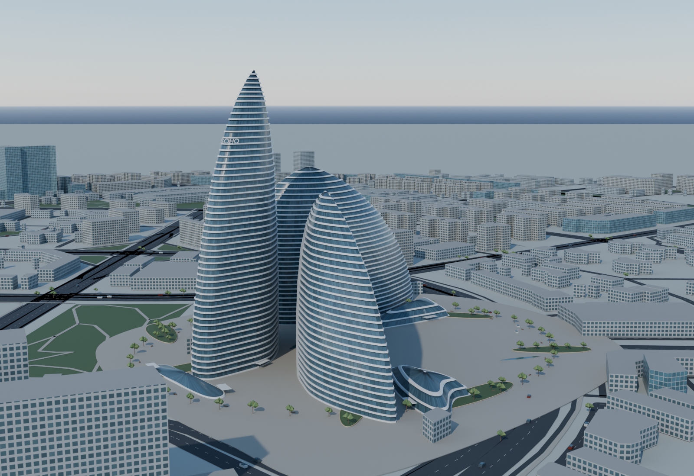
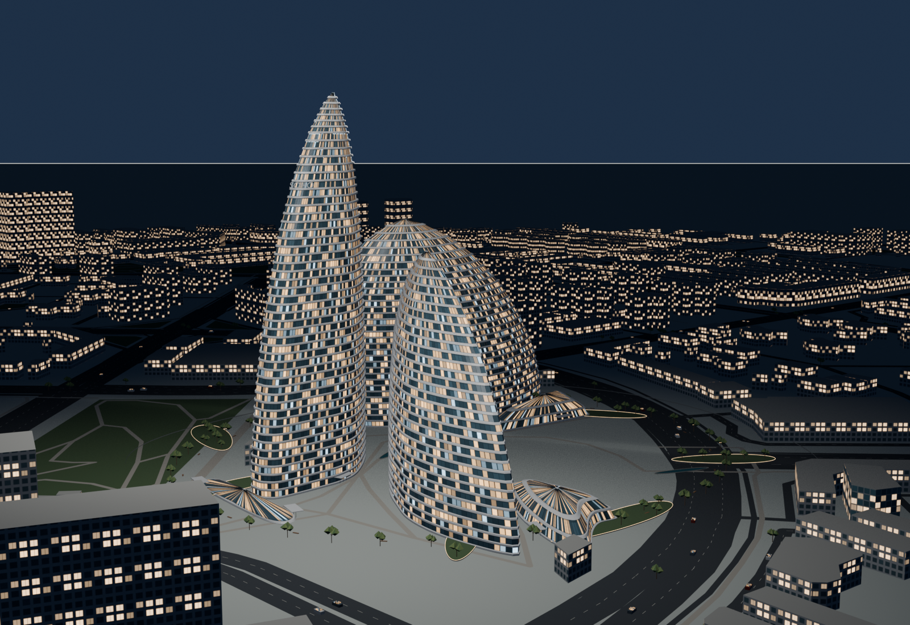

# 望京 SOHO · 空中构筑

三座流线塔楼、连续白铝遮阳带与镀膜玻璃，配套半径 1500 米的真实轮廓街区。建筑设计：Zaha Hadid Architects / CCDI；此处为 AIModels 独立展示重建。





## 交付

- [Blender 源工程](wangjing-soho.blend)：米制、打包纹理、404 个运动部件、可编辑 30 fps 拼装时间轴。
- [静态 GLB](https://jt-ai-models.vercel.app/models/wangjing-soho/wangjing-soho.glb)。
- [高空飞入拼装 GLB](https://jt-ai-models.vercel.app/models/wangjing-soho/wangjing-soho-assembly.glb)：30 s；构件向下飞入，在地上 85 m 完整组装，22–27 s 整体下降，保持至 30 s。
- [爆炸分解 GLB](https://jt-ai-models.vercel.app/models/wangjing-soho/wangjing-soho-explode.glb)：12 s，分层/外展分解并保持。
- [街区 3D Tiles](https://jt-ai-models.vercel.app/model-assets/geo-context/wangjing-soho-1500-v1/tileset.json)：1463 个建筑轮廓片、道路、绿地；与主体同锚点。
- [拼装预览视频](previews/assembly-preview.mp4)、[爆炸预览视频](previews/explode-preview.mp4)、[分镜与昼夜图](previews/)。视频是压缩预览，源工程与 GLB 保留完整采样。
- [任务书](model-brief.md)、[部件](parts.json)、[动画](animation.json)、[材质](materials.md)、[参考来源](references/README.md)、[验证摘要](verification/summary.json)。

目录 v1 只发现静态主模型与街区，不自动控制这两个动画。请把动画 GLB 交给支持 glTF 核心节点动画的播放器；有动画文件不等于当前 Cyber-Sight 普通模型卡已有拼装拖动面板。

## 精度与依赖

塔高 118/127/200 m 来自 ZHA/CTBUH，平面与北向来自 OSM，曲面和细节结合署名 ZHA 图纸及实景拟合。内部结构、第三低亭、场地细部为示意，非 BIM。街区只有 4 栋有源高度、55 栋按楼层估算、1403 栋按类型估算，不能当作精细测绘模型。

WGS84 116.47506° E / 39.99547° N；真实椭球高未知。目录与街区的 0 是椭球演示值。GEO_ROOT 不参与动画，glTF +X 北 / +Y 上 / +Z 东。

19 张参考原图已本地保存在 references/，版权归原作者。Git 中不再分发原图；提供下载脚本、URL、作者、哈希和用途。纹理为原创，已随 `.blend` 打包，GLB 自包含。公开源地理数据按 ODbL / CC BY 4.0 署名。

## 复现

在仓库根目录运行。Python 3.12+（此轮实际 Python 3.14.7）、Pillow、NumPy、Shapely、pyproj、mapbox-earcut；Blender 5.2.1 LTS。主构建不需要付费生成器或外部模型。

```powershell
python models/wangjing-soho/scripts/acquire.py
python tools/geo-context/fetch_context.py --config models/wangjing-soho/context-source-config.json --output models/wangjing-soho/references/overture
python models/wangjing-soho/scripts/prepare.py
blender --background --factory-startup --python models/wangjing-soho/scripts/build_model.py
python models/wangjing-soho/scripts/export_animation.py
python models/wangjing-soho/scripts/audit.py
blender --background models/wangjing-soho/wangjing-soho.blend --python models/wangjing-soho/scripts/render.py -- stills
blender --background models/wangjing-soho/wangjing-soho.blend --python models/wangjing-soho/scripts/render.py -- explode
blender --background models/wangjing-soho/wangjing-soho.blend --python models/wangjing-soho/scripts/render.py -- video
node models/wangjing-soho/scripts/validate.cjs
```

`node` 验证器依赖 `gltf-validator`；可安装到本机临时工具目录再通过 NODE_PATH 指向，避免向模型工程加入 node_modules。视频编码命令见 `scripts/encode_previews.ps1`。脚本不清空用户其他场景，重复制作只替换项目命名集合；推荐后台独立运行。

## 验证与限制

四个 GLB 的 Khronos 校验均 0 错误/0 警告。验证器仅忽略常量材质未使用 UV 的 UNUSED_OBJECT 信息，不忽略错误/警告。检查了导出 PBR、内嵌图片、单面、相机/灯排除、共同 t=0、严格递增采样时间、首末一致性、向下飞入、85 m 整体下降与保持。

Blender 图与 GLB 结构验证属于制作证据；Cyber-Sight 昼夜、实际 GPU/播放/首次 ready 和地形效果由维护者人工验收，此轮没有运行前端或浏览器自动化。
